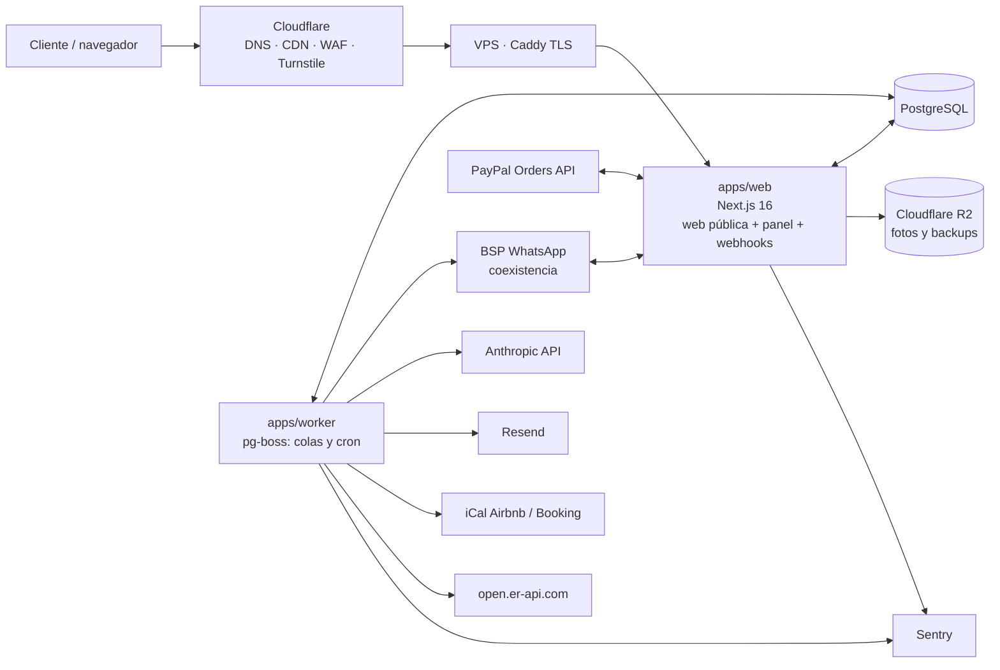

# Conexión Caribe – Plan de desarrollo del MVP

Versión 1.0 · 2026-10-17 · Basado en [REQUERIMIENTOS.md](REQUERIMIENTOS.md). Si hay diferencias, mandan REQUERIMIENTOS.md y luego este plan; el documento base queda en tercer lugar.

## 0. Resumen

- **Qué se construye:** el MVP de la Fase 1, ampliado con reservas inmediatas de traslados y alojamientos, pagos con PayPal, sincronización iCal y chatbot híbrido con IA.
- **Quién:** un desarrollador trabajando con Claude Code.
- **Cuánto tarda:** **13 a 17 semanas** a tiempo completo, repartidas en 7 hitos. Cada hito termina con una demo en staging.
- **Dónde corre:** un VPS con Docker detrás de Cloudflare. El costo estimado es de **USD 25 a 45 al mes**, dentro del límite de USD 50 (detalle en la sección 7).
- **Lo que no depende de programar y hay que empezar ya** (sección 6): verificar el negocio en Meta y elegir el BSP de WhatsApp, obtener las credenciales de PayPal, y redactar la política de cancelación y los textos legales.

## 1. Hallazgos de la verificación técnica

| Tema | Hallazgo | Impacto en el plan |
|---|---|---|
| Coexistencia de WhatsApp | Solo un **Solution Partner o Tech Provider** puede pasar a la API un número que se usa en la app Business. Requisitos: versión de la app ≥ 2.24.17 y número activo al menos 7 días. El historial se sincroniza solo en las primeras 24 h (hasta 180 días hacia atrás). El teléfono se desconecta tras unos 14 días sin uso. Throughput fijo de 20 mensajes por segundo. Los grupos no se sincronizan. Los mensajes enviados desde la app llegan por el webhook `smb_message_echoes`. | **Se usará un BSP con coexistencia** (decidido). El bot se pausa cuando llega un "echo" de un mensaje humano. Un adaptador permite cambiar de BSP o pasar a la Cloud API directa más adelante. |
| PayPal en RD | Las cuentas dominicanas pueden recibir pagos y retirar a un banco local (acuerdo con Banco Popular) o a una cuenta en EE. UU. | Viable. Hay que confirmar con PayPal la moneda de retiro y las comisiones. **Siempre se cobra en USD.** |
| Airbnb e iCal | Airbnb importa los calendarios externos **cada ~3 horas**. | Si nuestro sistema vende unas fechas, Airbnb puede tardar hasta 3 h en bloquearlas: hay **ventana de doble reserva**. Las mitigaciones están en la sección 4.2. |
| Tipos de cambio | `open.er-api.com` es gratis, sin clave, se actualiza a diario y tiene DOP, COP, EUR y CAD (hoy, 1 USD = 61,27 DOP). Exige un enlace de atribución y permite uso comercial. | Se adopta, con un tipo de cambio manual de respaldo en el panel. |
| VPS | Hetzner subió precios en abril y junio de 2026, y algunas líneas aparecen sin disponibilidad. DigitalOcean y Vultr cuestan de USD 18 a 24 por 4 GB. | Se presupuestan **USD 15 a 25 al mes**. El proveedor se elige al contratar. |
| Versiones actuales (npm) | Next.js 16.4, Prisma Client 7.10, Better Auth 1.7, next-intl 4.14, pg-boss 12, Tailwind 4.3 y `@paypal/paypal-server-sdk` 2.5. | Se fija Prisma 7.x estable: la etiqueta `latest` del CLI apunta a una 8.0 RC. |

## 2. Arquitectura



### Estructura del repositorio (monorepo pnpm)

```
apps/web          Next.js (App Router)
                  [locale]/…   web pública ES/EN/FR
                  admin/…      panel (solo en ES)
                  api/…        webhooks (BSP, PayPal), export iCal, checkout
apps/worker       procesos pg-boss: sync iCal, tipos de cambio, mensajes WA, traducciones IA, correos
packages/db       esquema Prisma, cliente, migraciones, seeds
packages/core     dominio puro y testeable: precios, disponibilidad, pipeline, máquina de estados del bot
packages/integrations  adaptadores: whatsapp, paypal, ai, email, storage, fx, ical
(UI)              HeroUI v3 (React Aria + Tailwind 4) en web y panel; tokens de marca en apps/web/src/app/globals.css
```

### Decisiones técnicas

| # | Decisión | Por qué | Alternativa descartada |
|---|---|---|---|
| 1 | **Next.js full-stack** (server actions en el panel, route handlers para webhooks y REST) | Un solo desarrollador y un solo despliegue. El SSR/ISR cubre el SEO. | NestJS aparte: duplica despliegue y tipos. El OpenAPI se genera desde zod solo para los endpoints REST públicos. |
| 2 | **pg-boss** para colas y cron | Corre sobre Postgres, así que hay un servicio menos que operar. El volumen es mínimo. | Redis + BullMQ |
| 3 | **Better Auth** con roles (varios por usuario) y 2FA TOTP | Trae roles y 2FA de serie y tiene adaptador Prisma. | Auth.js no incluye 2FA. |
| 4 | **R2 + `next/image`** con caché de Cloudflare | Sin costo de salida. Los backups van al mismo bucket. | Cloudinary queda como plan B si la CPU del VPS no alcanza. |
| 5 | **@react-pdf/renderer** para propuestas | No necesita Chrome headless en un VPS pequeño. | Playwright o Puppeteer |
| 6 | **next-intl**, con la lista de idiomas en configuración | Añadir PT/IT/DE es agregar un JSON, una entrada de configuración y traducir el contenido en el panel. | — |
| 7 | **Dinero en centavos USD (enteros)**. La conversión aplica tipo × (1 + margen) y es solo informativa. **PayPal cobra en USD.** | Evita errores de redondeo y de cobro en varias monedas. | — |
| 8 | **Interfaz `WhatsAppProvider`** (`sendText`, `sendInteractive`, `sendTemplate` y `parseWebhook`) | Permite cambiar de BSP o pasar a la Cloud API directa sin tocar el bot. | — |
| 9 | **IA con el SDK `@anthropic-ai/sdk` y structured outputs**. El modelo se configura en el panel. | La IA solo devuelve campos validados con zod. **Nunca redacta precios ni disponibilidad.** Los textos al cliente salen de plantillas. | — |
| 10 | **Docker Compose + Caddy**. GitHub Actions construye las imágenes en GHCR y despliega por SSH. Staging y producción en el mismo VPS, con bases separadas. | Despliegue simple y transparente para un solo responsable. | Coolify o Dokploy: consumen más RAM. |
| 11 | **Vitest** para `core` (precios, disponibilidad, bot) y **Playwright** para E2E | El dinero y las reservas necesitan tests deterministas. | — |
| 12 | **Sentry** (plan gratis), logs con pino y rotación de Docker, monitor de uptime gratuito. Backup diario con `pg_dump` a R2 (30 días) y una prueba de restauración al mes. | Cumple la sección 12 del documento base a costo cero. | — |
| 13 | **HeroUI v3** como librería de componentes, en la web y en el panel (pedido del desarrollador) | Accesible (React Aria) y basada en Tailwind 4. El tema se ajusta con variables CSS a la paleta de marca. | shadcn/ui |

## 3. Modelo de datos (ajustes al documento base)

**Se mantiene**, como en la sección 11 del documento base: `customers`, `leads`, `conversations`, `messages`, `catalog_items`, `catalog_translations`, `media`, `price_rules`, `suppliers`, `supplier_contacts`, `packages`, `trips`, `trip_items`, `proposals`, `payments`, `agencies`, `exchange_rates`, `settings` y `audit_log`.

**Cambia:**

| Tabla | Cambio |
|---|---|
| `users` | Un usuario puede tener **varios roles** (el equipo es de 1 o 2 personas). |
| `vehicles`, `vehicle_bookings`, `drivers` | **Eliminadas.** Las reemplazan `vehicle_types` (categoría, pasajeros, maletas), `transfer_routes` (origen y destino por zona o aeropuerto) y `transfer_rates` (ruta × tipo de vehículo: precio, costo y recargo nocturno). El rent a car es un `catalog_item` con tarifas por día y por semana, depósito y seguro. |
| `trip_items` | Suma la asignación de cada servicio: proveedor, conductor y vehículo como texto, y el estado del servicio. |
| `properties` | Suma `ical_import_urls[]`, `ical_export_token`, ubicación aproximada (lat/lng con desplazamiento), estancia mínima, limpieza, depósito y horarios de check-in y check-out. |
| `availability_blocks` | Origen: `ICAL_AIRBNB`, `ICAL_BOOKING`, `RESERVA_INTERNA`, `MANUAL` o `HOLD`, con el UID externo. |
| `payments` | Tipo (`DEPOSIT`, `BALANCE` o `REFUND`), método (PayPal, transferencia, efectivo, tarjeta u otro) y los IDs de orden y de captura de PayPal. |

**Nuevas:**
- `bot_sessions`: estado de la máquina de estados, datos recogidos y `paused_until`.
- `checkout_holds`: bloqueo temporal de fechas durante el pago.
- `consents`: opt-in de WhatsApp, consentimiento de cada propietario y aceptación de términos (con versión).
- `wa_templates`: plantillas de Meta y su estado.
- `supermarket_products`.
- `applications`: solicitudes de agencias y propietarios pendientes de revisión.

## 4. Flujos que el MVP debe resolver

### 4.1 Reserva inmediata de traslado (web)
1. El cliente elige origen (PUJ u otro aeropuerto, o una zona), destino, fecha y hora, número de vuelo, pasajeros y maletas.
2. El sistema muestra los tipos de vehículo con capacidad suficiente y su precio: tarifa de la ruta más el recargo nocturno.
3. El cliente da sus datos, acepta los términos (se guarda la versión) y, si quiere, da el opt-in de WhatsApp.
4. Paga el **30 % con PayPal**. La captura se confirma en el servidor y por webhook.
5. Se crea un `trip` en estado **Pagado (anticipo)**. El cliente recibe correo y WhatsApp con el enlace a "Mi viaje", y el equipo recibe aviso para asignar el proveedor.
6. La antelación mínima (por ejemplo, 24 h) se configura en el panel. Por debajo de ese límite, la reserva pasa a solicitud.

### 4.2 Reserva inmediata de alojamiento (web)
1. El cliente elige fechas. La disponibilidad sale de `availability_blocks`.
2. El precio se calcula por noche y temporada, más la limpieza, y se exige la estancia mínima.
3. Al empezar el pago, el sistema bloquea las fechas 15 minutos (`HOLD`) y **relee en ese momento el iCal** del propietario (con un tiempo límite). Si aparece un conflicto, se cancela antes de cobrar.
4. El cliente paga el 30 % con PayPal. Se crea un bloque `RESERVA_INTERNA` y el **iCal de exportación** queda actualizado. El propietario debe tenerlo importado en Airbnb y Booking.
5. **El propietario recibe aviso inmediato** por WhatsApp o correo para que bloquee las fechas o fuerce "Actualizar" en Airbnb, porque la importación tarda unas 3 h.
6. Si aun así hay un choque, se aplica la política acordada con el cliente: reubicar en una propiedad equivalente o reembolsar el 100 %. **Esta política está por definir** (sección 8).

### 4.3 Lead por WhatsApp
1. Los botones de la web abren WhatsApp con un mensaje y un **código de origen**, por ejemplo `[CC-EXC-SAONA]`.
2. El BSP envía el mensaje a nuestro webhook y arranca la máquina de estados: idioma → propósito → datos del viaje → detalles por servicio → resumen.
3. Si el cliente escribe texto libre, la IA extrae los campos; si no entiende dos veces seguidas, deriva a una persona. Las quejas y urgencias se escalan al momento.
4. Se crea el lead y un `trip` borrador con todo el historial. El agente recibe aviso en el panel y por correo.
5. El agente responde desde la app del móvil. El webhook `smb_message_echoes` lo detecta y el bot se pausa en esa conversación (tiempo configurable).
6. Fuera de horario, el bot toma los datos y avisa cuándo se responderá.
7. Se respetan el opt-in y el "STOP".

### 4.4 Cotización y propuesta (panel)
1. El agente arma el paquete con elementos del catálogo, fechas y cantidades.
2. El sistema calcula el total en USD y en la moneda del cliente. El costo y el margen solo los ven los roles internos, y se pueden aplicar descuentos.
3. Se genera la **propuesta en PDF** y una **página privada** `/p/[token]` donde el cliente acepta o pide cambios.
4. Al aceptar, se cobra el 30 % con PayPal. Esa misma página de pago es el "enlace PayPal desde el panel".
5. Los saldos y los pagos en otras vías los registra el agente manualmente.

### 4.5 Mi viaje (básico en el MVP)
- Página `/mi-viaje/[token]` en el idioma del cliente, sin contraseña.
- Muestra los servicios confirmados en orden cronológico, los datos del traslado, los pagos (hechos y pendientes), contactos y el botón de WhatsApp.
- La línea de tiempo completa con documentos queda para la Fase 2.

> La página de propuesta con aceptación y "Mi viaje" básico estaban en la Fase 2. Pasan al MVP porque los pagos en línea los necesitan.

## 5. Hitos

| Hito | Semanas | Contenido | Demo de cierre |
|---|---|---|---|
| **M0 · Fundaciones** | 1 a 1,5 | Repositorio y monorepo, CI (typecheck, lint, tests), Docker Compose, VPS, Caddy y Cloudflare, staging y producción, Postgres y backups a R2, Sentry. Better Auth con roles y 2FA. Esqueleto de i18n. Tokens de marca y layout base a partir del prototipo (mejorado). | Login al panel con 2FA en staging; despliegue automático al hacer merge. |
| **M1 · Catálogo** | 2 a 2,5 | CRUD de los 6 tipos de elemento. Traducciones ES/EN/FR con botón "Traducir con IA" y revisión. Galería con orden y foto principal, subida masiva a R2. Reglas de precio y temporadas. Proveedores y costo interno. Estados, duplicar y vista previa. Importación y exportación CSV (con plantilla para la carga inicial). Historial de cambios. Solo el administrador cambia precios. | Crear una excursión con fotos, precios y traducciones, e importar el catálogo del cliente desde CSV. |
| **M2 · Web pública** | 2 a 2,5 | Todas las páginas del documento base (sección 5) alimentadas por el catálogo. Selector de idioma y de moneda (job diario de tipos de cambio más margen). Aviso de "precio referencial" en todos los precios. Botones de WhatsApp con código de origen. Formularios "Arma tu viaje", corporativo, "Quiero ser aliado" y "Publicar mi propiedad", que crean leads tipados y notifican al equipo (con Turnstile y rate limit). SEO: hreflang, sitemap, robots, JSON-LD y metadatos. Revalidación inmediata al publicar. Páginas legales y banner de cookies. Lista básica de leads en el panel. | Publicar en el panel y verlo en la web en menos de 1 minuto. Lighthouse ≥ 90 en móvil y sin errores graves de accesibilidad. |
| **M3 · Reservas y pagos** | 2,5 a 3 | Motor de precios para traslados y alojamientos. Importación iCal cada 30 minutos y exportación iCal por propiedad. Calendario de disponibilidad en el panel. Checkout de traslados y alojamientos con holds y relectura del iCal. PayPal Orders (crear, capturar, webhooks, reembolso). Página de pago genérica `/pagar/[token]`. Registro de pagos manuales. Correos transaccionales. "Mi viaje" básico. Avisos a propietarios. | Reserva completa de un traslado y de un alojamiento con PayPal sandbox. Las fechas aparecen bloqueadas en el iCal exportado. |
| **M4 · WhatsApp y bot** | 2,5 a 3 | Adaptador del BSP. Webhook con verificación de firma. Registro de conversaciones y mensajes. Máquina de estados ES/EN/FR con botones y listas (los servicios salen del catálogo). Código de origen. Capa de IA para texto libre. Traspaso a humano y pausa por echo. Modo fuera de horario. Opt-in y opt-out. Envío de plantillas a aprobación. Avisos al agente. | Onboarding completo con el número de prueba: el lead aparece en el panel con todos los datos y el historial. |
| **M5 · CRM y propuestas** | 2 a 2,5 | Ficha de cliente e historial. Pipeline en kanban con estados alternos. Constructor de paquetes con totales, costo, margen y descuentos. Propuesta en PDF y página `/p/[token]` con aceptar o pedir cambios, más el pago del 30 %. Envío por WhatsApp (plantilla) y correo. Dashboard básico: leads nuevos, propuestas pendientes, llegadas de la semana e ingresos estimados. | Armar un paquete con alojamiento, traslado y excursión, enviarlo, aceptarlo y pagarlo en sandbox. |
| **M6 · Estabilización y salida** | 1 a 1,5 | E2E de los flujos 4.1 a 4.4. Revisión de seguridad (`/claude-security`) y auditoría (`/thermos`). Rendimiento y accesibilidad. Carga final del catálogo real. Prueba de restauración del backup. Manual del equipo. Pase a PayPal live y al número real por coexistencia. Checklist de salida. | Criterios de aceptación de la sección 9 cumplidos en producción. |

**Por qué este orden:** todo depende del catálogo (M1). La web (M2) es la primera fuente de leads. PayPal se puede desarrollar en sandbox sin esperar la política de cancelación (M3). WhatsApp va en M4 para dar tiempo a la verificación en Meta y a la elección del BSP. El CRM y las propuestas (M5) usan todo lo anterior.

## 6. Ruta crítica externa (empezar en paralelo desde la semana 1)

| # | Tarea | Responsable | Necesario en | Bloquea |
|---|---|---|---|---|
| 1 | Comprar el dominio | Cliente o tú | M0 | Staging con HTTPS, correo |
| 2 | Archivo HTML del prototipo en esta carpeta | Tú | M0 | Tokens de marca y páginas |
| 3 | Cuenta de la API de Anthropic con facturación | Cliente o tú | M1 | Traducciones con IA |
| 4 | Catálogo real en la plantilla CSV (se entrega en M1), con fotos, logo y precios | Cliente | M1 y M2 | Contenido real y SEO |
| 5 | Credenciales REST de PayPal Business (sandbox y live). Confirmar con PayPal la moneda de retiro y las comisiones. | Cliente | M3 | Pagos |
| 6 | Reglas de traslados (antelación, recargos, equipaje) y de alojamientos (estancia mínima, limpieza, depósito, horarios) | Cliente | M3 | Motor de precios |
| 7 | Consentimiento de cada propietario, URLs iCal de Airbnb y Booking, y su compromiso de importar nuestro iCal | Cliente | M3 | Reserva inmediata de alojamientos |
| 8 | Crear Meta Business Manager y **verificar el negocio** (puede tardar días o semanas) | Cliente, con tu ayuda | M4 | Chatbot en producción |
| 9 | Comparar 2 o 3 BSP con coexistencia (precio, plan gratuito, webhooks) y elegir uno | Tú | Antes de M4 | M4 |
| 10 | Redactar los textos de las plantillas de WhatsApp (bienvenida, propuesta, confirmación, recordatorio) | Tú y cliente | M4 | Mensajes fuera de las 24 h |
| 11 | **Política de cancelación y reembolso**, términos y privacidad revisados por un abogado | Cliente | **Antes de M6** | **Salida a producción de los pagos** |
| 12 | Mantener el número activo en la app Business y tener un teléfono con cámara para el QR | Cliente | M4 a M6 | Coexistencia |

## 7. Presupuesto mensual estimado (volumen actual)

| Concepto | USD al mes |
|---|---|
| VPS de 4 a 8 GB (web, worker, Postgres, staging) | 15 a 25 |
| Dominio (prorrateado) | 1 a 2 |
| Cloudflare (DNS, CDN, Turnstile) y R2 (≤ 10 GB) | 0 |
| Resend (≤ 3.000 correos), Sentry, uptime y tipos de cambio | 0 |
| Mensajes de Meta. Responder dentro de la ventana de 24 h no tiene costo, y las plantillas utility dentro de esa ventana tampoco; el resto se cobra por mensaje (a confirmar con el BSP). | 1 a 3 |
| BSP | 0 si el plan gratuito incluye coexistencia (**por verificar**). Si no, puede **romper el presupuesto** (hay planes desde ~USD 39). |
| IA, por defecto **Claude Opus 5.5** (`claude-opus-5-5`, USD 4 / 20 por millón de tokens): unas 600 llamadas al mes del bot más traducciones | 8 a 15 |
| IA, si eliges **Claude Haiku 5.5** (`claude-haiku-5-5`, USD 0,10 / 0,50 por millón de tokens) | menos de 1 |
| **Total** | **~25 a 45** con Opus 5.5 (o ~17 a 30 con Haiku 5.5) **+ BSP** |

PayPal cobra una comisión por transacción, que no es un costo fijo mensual.

## 8. Decisiones abiertas

1. **Modelo de IA.** Por defecto se usa Claude Opus 5.5. Claude Haiku 5.5 cuesta más de 10 veces menos y puede bastar para extraer campos. Decide tú según el presupuesto. El modelo queda configurable en el panel, y se puede medir con conversaciones reales en M4 antes de fijarlo.
2. **BSP concreto**, tras la comparación de la tarea 9.
3. **Política ante doble reserva de alojamiento** (reubicar o reembolsar), con el cliente.
4. **Proveedor de VPS**, al contratar.
5. **Repositorio:** `git init` y un repositorio privado en GitHub (¿en tu cuenta o en la del cliente?).

## 9. Criterios de aceptación del MVP (actualizados)

Se mantienen los de la sección 14 del documento base, más estos:

- Un cliente puede **reservar y pagar el 30 %** de un traslado y de un alojamiento en la web, y la reserva aparece en el panel como Pagado (anticipo).
- Las fechas vendidas aparecen en el iCal exportado, y las fechas ocupadas en Airbnb o Booking se bloquean en la web en menos de 1 hora.
- Un cliente puede aceptar una propuesta y pagarla desde `/p/[token]`.
- Si un agente responde desde la app del móvil, el bot se pausa en esa conversación.
- Ningún mensaje del bot incluye un precio que no salga del catálogo, y todos llevan la aclaración de que es referencial.

## 10. Fuera del MVP

| Fase 2 | Fase 3 |
|---|---|
| Módulo de operaciones (agenda diaria, confirmación al proveedor), recordatorios automáticos a 48 y 24 h, línea de tiempo completa de "Mi viaje" con documentos, bandeja de WhatsApp en el panel si llega a hacer falta, reportes | Azul o CardNET, portales de propietarios y de agencias (tarifas netas), channel manager (Hostaway, Guesty…), reseñas, PT/IT/DE |

## 11. Forma de trabajo

- **Un hito = una rama y un PR.** El CI corre typecheck, lint y tests, y el merge despliega a staging. Al final de cada hito hay una demo al cliente.
- Se sigue el pipeline de `~/.claude/CLAUDE.md`. Hay que mirar el **número** de tests que pasan, no solo el código de salida. Antes de los PR de M0 (auth), M3 (dinero) y M4 (webhooks) se pasa `/claude-security`, y antes de cada PR, `/thermos` y `/code-review`.
- Cada hito parte de un mini-plan detallado: tareas, archivos y tests.

## Fuentes

- Meta, coexistencia: [Onboarding WhatsApp Business app users](https://developers.facebook.com/documentation/business-messaging/whatsapp/embedded-signup/onboarding-business-app-users) · [Get started for Tech Providers](https://developers.facebook.com/documentation/business-messaging/whatsapp/solution-providers/get-started-for-tech-providers)
- 360dialog: [Coexistence webhooks](https://docs.360dialog.com/partner/waba-management/whatsapp-coexistence/coexistence-webhooks) · [Coexistence onboarding](https://docs.360dialog.com/partner/waba-management/phone-number-and-hosting/whatsapp-coexistence/coexistence-onboarding)
- YCloud (plan gratuito y coexistencia, información de marketing por verificar): [ycloud.com](https://www.ycloud.com/)
- PayPal RD: [Opciones de retiro](https://paypal.com/do/webapps/mpp/withdrawal-options) · [Retiros para negocios](https://www.paypal.com/do/webapps/mpp/business-support/withdrawals)
- Airbnb: [Sincronizar calendarios (artículo 99)](https://www.airbnb.com/help/article/99)
- Tipos de cambio: [ExchangeRate-API Open Access](https://www.exchangerate-api.com/docs/free)
- Hetzner 2026: [wz-it.com](https://wz-it.com/en/blog/hetzner-price-increase-june-2026-cpx-ccx-alternatives/) · [northflank.com](https://northflank.com/blog/hetzner-cloud-server-price-increases) · [findstack.com](https://findstack.com/resources/hetzner-price-increase-2026) · [Comparativa de VPS](https://apicalculators.com/blog/cloud-vps-cost-comparison-2026)
